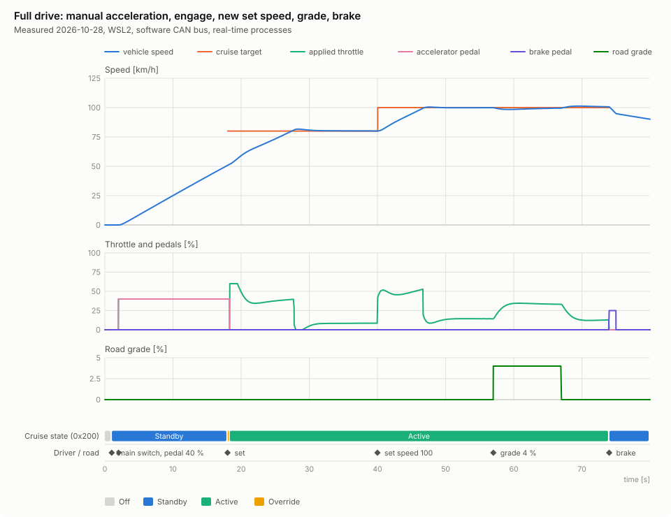
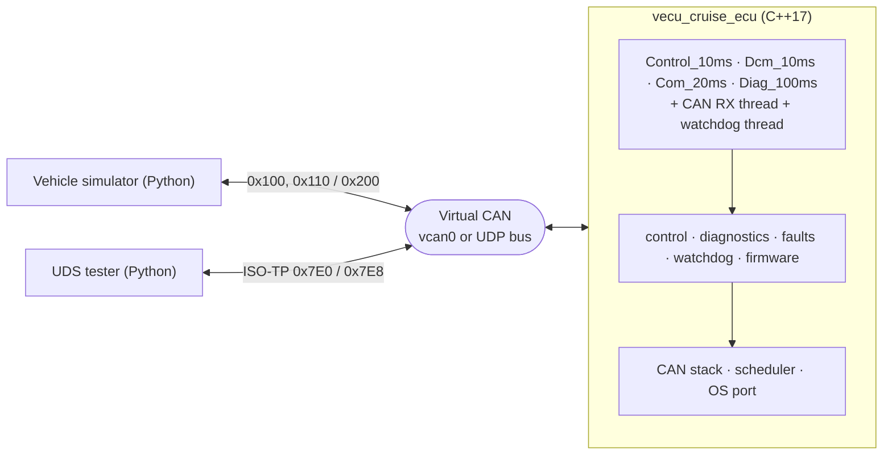
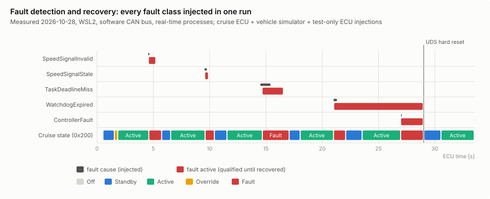
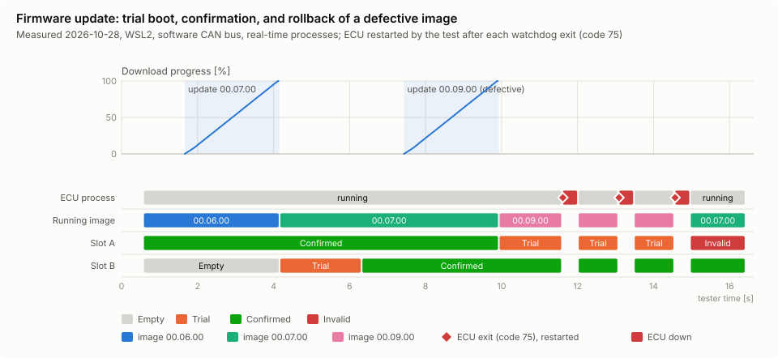
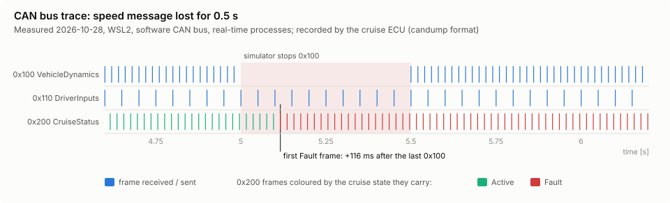
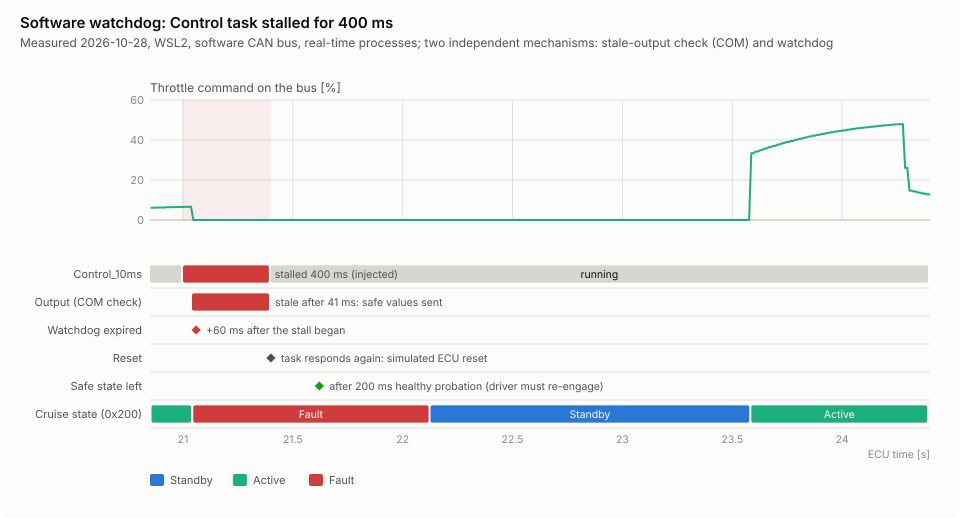

# Virtual Automotive ECU Platform

[](https://github.com/harishnr93/virtual-automotive-ecu/actions/workflows/ci.yml)


Automotive ECU software in **C++17**, with a vehicle simulator and test tooling in **Python**,
running on Linux/WSL2 with **no hardware**. Virtual ECUs talk over a virtual CAN bus. The cruise
control ECU runs:
- a periodic task scheduler
- a PID cruise controller
- a UDS diagnostic server over ISO-TP
- fault management with DTCs
- a software watchdog
- an A/B firmware update with rollback

Everything is tested automatically and the performance is measured.

> **Scope.** This is an educational simulation. It applies ideas from AUTOSAR Classic,
> ISO 14229 (UDS), ISO 15765-2 (ISO-TP) and ISO 26262 *as engineering practice*. It does **not**
> claim compliance with any standard, safety certification, MISRA compliance or hard real-time
> behaviour. Linux is not an RTOS, so all timing figures below are measurements on one machine,
> not guarantees. Where something is simulated, the documentation says so.



---

## What it does

| Area | Highlights | Details |
|---|---|---|
| **Virtual CAN** | one `ICanChannel` interface with three implementations: SocketCAN (`vcan0`), a UDP-multicast software bus (WSL2 has no vcan), an in-memory test bus. DBC-based signal codec (Intel/Motorola), timeout and alive-counter supervision, candump-format logging | [Phase 1](docs/phase1_virtual_can.md) |
| **Scheduler** | 10/20/100 ms tasks, one thread each, absolute release times, OSEK-style activation limit, rate-monotonic priorities, priority-inheritance mutex; execution time, latency, jitter and deadline misses measured for every activation; OS port ready for an RTOS | [Phase 2](docs/phase2_scheduler.md) |
| **Cruise control** | PID with saturation, anti-windup, feedforward, bumpless transfer; Off/Standby/Active/Override/Fault state machine; brake and accelerator override; safe fallback on sensor faults. A Python longitudinal vehicle model closes the loop over CAN | [Phase 3](docs/phase3_cruise_control.md) |
| **Diagnostics** | ISO-TP and a UDS server (0x10, 0x11, 0x14, 0x19, 0x22, 0x31, 0x34, 0x36, 0x37, 0x3E) with sessions, negative responses and functional addressing; a separate Python tester implementation | [Phase 4](docs/phase4_diagnostics.md) |
| **Fault management** | DEM/FiM-like debouncing, recovery, latched faults, function inhibition; DTC status bits and aging persisted in a CRC-protected NVM file | [Phase 5](docs/phase5_fault_management.md) |
| **Watchdog** | software supervision of heartbeats, execution times and stalls; safe state, then simulated reset or real process restart; a stale-output check independent of the watchdog | [Phase 5](docs/phase5_fault_management.md) |
| **Firmware update** | image header + CRC-32, simulated NOR flash with power-loss injection, A/B slots, redundant boot record, UDS programming, trial boot with automatic rollback. **CRC-32 detects corruption; it does not authenticate.** | [Phase 6](docs/phase6_firmware_update.md) |
| **Validation** | 369 tests (GoogleTest + pytest) incl. multi-process system tests; GCC `-Werror`, ASan/UBSan, ThreadSanitizer, cppcheck, clang-tidy; code coverage (gcov); libFuzzer targets for every input parser; one-command regression, performance and figure runs; GitHub Actions CI | [Phase 7](docs/phase7_validation.md), [coverage & fuzzing](docs/coverage_and_fuzzing.md) |

## Architecture



More in [docs/architecture.md](docs/architecture.md): layers, tasks and data flow, sequence
diagrams and state machines. The reasons behind the design are in
[docs/engineering_decisions.md](docs/engineering_decisions.md).

## Measured results

From [docs/performance_report.md](docs/performance_report.md), generated on 2026-10-26 by
`scripts/run_performance.py` (AMD Ryzen 7 4800H with Radeon Graphics, 16 logical CPUs, WSL2 kernel 6.6.87.2, GCC 11.4, `SCHED_OTHER`).

| Measurement | Result |
|---|---|
| Scheduler, 10 ms task, light load | 0 deadline misses in 999 activations; start latency p99 499 µs |
| Scheduler with 16 CPU-stress threads | 0 deadline misses; start latency max 9.4 ms |
| CAN latency (one-way, software bus) | median 80 µs, p99 217 µs, 0 of 5000 frames lost |
| Cruise step 60 → 80 km/h over CAN | overshoot 0.88 km/h, settling (±0.5 km/h) 8.15 s, steady-state error 0.03 km/h |
| 4 % uphill grade at 90 km/h | max speed drop 1.43 km/h, recovered in 8.6 s |
| Fault detection (sensor message lost / speed invalid) | cruise Fault and 0 % throttle on the bus after 120 ms / 40 ms |
| Control task stalled | frozen output blocked after 41 ms; watchdog expired after 60 ms |
| UDS response while cruising | single frame median 10.0 ms, multi-frame median 20.0 ms (P2 = 50 ms) |
| Firmware update, 64 KiB image over ISO-TP | 19.8 KiB/s, 3.3 s for erase + download + check |
| Failure handling | power loss at 21 points / SIGKILL during download: old image always boots; defective image: 3 trial boots, then automatic rollback |

Verification (2026-10-28): all 274 CTest entries (369 tests) pass in the GCC `-Werror`, ASan + UBSan and
Clang ThreadSanitizer builds; the 5 fuzz targets pass their smoke run and found nothing in a 5-minute
campaign (~243 million inputs); cppcheck and clang-tidy report no findings; the tests cover
87.0 % of the product code's lines and 94.7 % of its functions ([coverage report](docs/coverage_report.md)).

## Results gallery

Drawn from real runs by `./scripts/make_figures.py`. All 12 figures, and how to read them, are in
[docs/results_gallery.md](docs/results_gallery.md).

| | |
|---|---|
|  |  |
| **Fault management:** every fault class injected in one run, qualified, reported and recovered | **Firmware update:** trial boot, confirmation, and automatic rollback of a defective image |
|  |  |
| **On the bus:** the speed message stops, the cruise ECU reports Fault after the timeout | **Watchdog:** a stalled task, safe values on the bus, reset and recovery |

## Quick start (WSL2 / Ubuntu 22.04)

```bash
sudo apt install -y build-essential cmake libgtest-dev python3-pytest   # once
./scripts/check_env.sh                       # toolchain + vcan check

cmake -S . -B build -DVECU_WARNINGS_AS_ERRORS=ON
cmake --build build -j"$(nproc)"
ctest --test-dir build -j"$(nproc)"          # all 274 CTest entries, ~3 min
```

Optional: `sudo apt install -y clang cppcheck clang-tidy` for the sanitizer and analysis stages.

## Try it

```bash
# Closed loop: cruise ECU + vehicle simulator, 80 s scenario with plot and KPIs
./scripts/run_closed_loop.sh

# While an ECU runs (other terminal): diagnostics
./scripts/uds_tester.py info live "dtc 08"
./scripts/vbus_dump.py                       # watch the software CAN bus like candump

# Firmware update with a persistent flash file
./build/bin/vecu_cruise_ecu --flash /tmp/ecu_flash.bin --confirm-after 3     # terminal 1
./scripts/fwtool.py build --version 0.7.0 --out /tmp/fw.bin                    # terminal 2
./scripts/uds_tester.py "flash /tmp/fw.bin" fw-status

# Fault injection (test-only): stall the control task for 0.4 s after 3 s
./build/bin/vecu_cruise_ecu --inject stall:Control_10ms:3.0:0.4 --duration 6

# Validation
./scripts/run_regression.sh                  # GCC, ASan/UBSan, TSan, fuzzing, static analysis (~12 min)
./scripts/run_coverage.sh                    # line/function coverage of all tests -> docs/coverage_report.md
./scripts/run_performance.py                 # regenerate docs/performance_report.md (~1.5 min)
./scripts/make_figures.py                    # regenerate the result figures (~2.5 min)
```

## Repository layout

```
include/, src/      libraries: core (OS port, scheduler, timing, logger, CRC), can, control,
                    diagnostics (ISO-TP, UDS), faults (fault manager, DTCs, NVM), watchdog,
                    firmware (image, flash model, boot record, bootloader, update manager)
apps/               executables: cruise_ecu, sensor_ecu, sched_bench, can_latency (+ common runtime)
simulator/vecu_sim/ Python: vehicle model, scenarios, DBC codec, CAN buses, ISO-TP/UDS tester,
                    firmware image format, analysis and plots
config/             CAN matrix (DBC) and scenarios (JSON)
tests/              unit/ (GoogleTest + pytest), integration/ (real sockets, threads, processes),
                    fuzz/ (libFuzzer targets and seed corpora)
scripts/            environment check, demos, bus tools, UDS tester, firmware tool,
                    regression, performance, static analysis
docs/               architecture, decisions, per-phase documentation, performance report
.github/workflows/  CI
```

## Documentation

- [Architecture](docs/architecture.md) · [Engineering decisions](docs/engineering_decisions.md) · [Performance report](docs/performance_report.md) · [Results gallery](docs/results_gallery.md) · [Coverage & fuzzing](docs/coverage_and_fuzzing.md)
- [Phase 1 — Development environment and virtual CAN](docs/phase1_virtual_can.md)
- [Phase 2 — ECU scheduler](docs/phase2_scheduler.md)
- [Phase 3 — Vehicle simulation and cruise control](docs/phase3_cruise_control.md)
- [Phase 4 — UDS diagnostics over ISO-TP](docs/phase4_diagnostics.md)
- [Phase 5 — Fault management and watchdog](docs/phase5_fault_management.md)
- [Phase 6 — Firmware update simulation](docs/phase6_firmware_update.md)
- [Phase 7 — Validation, CI and documentation](docs/phase7_validation.md) (incl. requirements traceability)

## Limitations

- **No hardware and no real-time OS.** Timing behaviour on a microcontroller with an RTOS would be
  different and must be measured there. The OS port is the place to start.
- **The software CAN bus** has no bit timing, arbitration, error frames or bus-off. SocketCAN
  support is implemented but could not be exercised on WSL2 (no `vcan` module).
- **Security is out of scope:** no SecurityAccess, no image signatures, no secure boot. CRC-32
  only catches accidental corruption.
- **Software watchdog** inside the ECU process, not a hardware watchdog.
- **Subset of UDS**, documented per service. Firmware "images" are data that drive the ECU's
  behaviour, not executable code.
- **Test-only fault injection** is compiled into the ECU binary (inactive unless requested).

## License

MIT, see [LICENSE](LICENSE).
