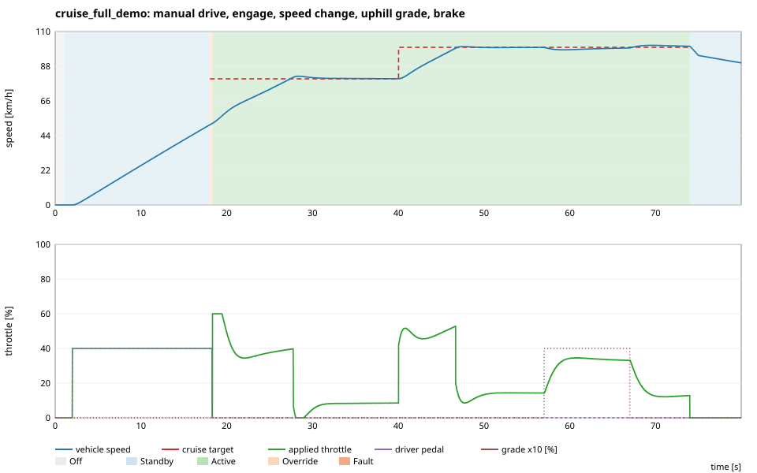

# virtual-automotive-ecu

A hardware-free automotive embedded software platform in C++17 and Python. It simulates
several ECUs that communicate over a virtual CAN network, and it covers periodic
scheduling, cruise control, UDS diagnostics, fault management, watchdog supervision,
firmware-update simulation and automated validation.

> **Scope note.** This is an educational, simulation-only project. It runs on Linux/WSL2
> without any microcontroller or CAN hardware. It borrows ideas from AUTOSAR Classic,
> ISO 14229 (UDS), ISO 15765-2 (ISO-TP) and ISO 26262 *as engineering practice*. It does
> not claim compliance, certification or hard real-time behaviour.

## Status

| Phase | Content | Status |
|---|---|---|
| 1 | Environment, CAN stack, two virtual ECUs, tests | ✅ done |
| 2 | Periodic ECU scheduler (10/20/100 ms), timing measurement | ✅ done |
| 3 | Python vehicle simulator, PID cruise control | ✅ done |
| 4 | ISO-TP + UDS diagnostic server | ✅ done |
| 5 | Fault management, DTCs, software watchdog | ✅ done |
| 6 | Firmware update simulation (CRC32, A/B partitions, rollback) | ⏳ planned |
| 7 | Regression suite, performance report, CI, documentation | ⏳ planned |

## What works today (Phases 1–5)

- **CAN abstraction** `ICanChannel` with three interchangeable backends:
  - Linux **SocketCAN** (`vcan0` / real `can0`)
  - a **UDP-multicast software CAN bus**, used automatically when the kernel has no vcan
    driver (as on stock WSL2)
  - an **in-process bus** for deterministic unit tests
- **DBC-compatible signal codec**: Intel and Motorola bit layouts, factor/offset scaling,
  signed values, range clamping and checks. The CAN matrix in [`config/vehicle_can.dbc`](config/vehicle_can.dbc)
  is checked against the C++ tables by a unit test.
- **Communication supervision**: message timeout monitoring with a first timeout,
  4-bit alive counters, DLC and range checks.
- **Two virtual ECUs** (separate processes): a sensor ECU publishing vehicle data and a
  cruise ECU communication skeleton that supervises its inputs and enters `Fault` on
  communication loss.
- **Periodic task scheduler**: one thread per task with rate-monotonic priorities.
  - **Timing:** absolute-time releases with no drift.
  - **Overruns:** handled OSEK-style, with skipped activations counted.
  - **Detection:** deadline misses and execution-budget overruns.
  - **Measurement:** execution time, start latency, jitter and response time for every
    activation, reported as a table, a summary line per task, or JSON.
- **Priorities:** `SCHED_FIFO` priorities are requested only when asked and fall back
  to normal scheduling when not permitted. The ECU reports which policy it actually got.
- **Inter-task data exchange**: `SharedSignal<T>` with timestamps and sequence numbers, so
  stale data can be detected. Priority-inheritance mutexes prevent unbounded priority inversion.
- **OS abstraction layer** (`os_port`): threads, absolute sleep and a PI mutex. A
  FreeRTOS/Zephyr port would replace only this layer.
- **Event-driven CAN reception**: an RX thread, the equivalent of a receive interrupt,
  feeds a bounded queue that the COM task drains.
- **ECU task sets:**
  - cruise ECU: Control_10ms, Com_20ms, Diag_100ms
  - sensor ECU: Com_10ms, Diag_100ms
- **Cruise control** (`src/control`, independent of CAN and threads):
  - PID controller with saturation, anti-windup (clamping / back-calculation), derivative
    filter, feedforward and bumpless transfer
  - state machine: Off / Standby / Active / Override / Fault
  - brake and accelerator override
  - sensor-timeout, invalid-speed and stale-data handling, with a safe fallback to 0 % throttle
  - recovery only to Standby, never straight back to Active
- **Python vehicle simulator**:
  - longitudinal dynamics: drag, rolling resistance, grade, power limit, actuator lag
  - JSON driver/road/fault scenarios and actuator-side command arbitration
  - reads the same DBC file as the ECU
  - CSV, SVG and KPI reports, with no third-party packages
- **UDS diagnostics** (educational, inspired by ISO 14229-1), served by a `Dcm_10ms` task:
  - **ISO-TP transport** (ISO 15765-2): single, first, consecutive and flow-control frames,
    block size, STmin, timeouts, up to 4095 bytes
  - **services:** 0x10 sessions (default/extended, S3 timeout), 0x11 simulated ECU reset,
    0x14 clear DTCs, 0x19 read DTCs, 0x22 read data (13 DIDs), 0x3E tester present
  - negative response codes, suppress-positive-response bit and functional addressing (0x7DF)
  - **DTC memory** with ISO 14229 status bits, fed by timeout, plausibility and
    controller-fault monitors
  - **Python tester**: a separate ISO-TP/UDS implementation plus the `uds_tester.py`
    command-line tool
- **Fault management** (AUTOSAR DEM/FiM-like, simplified):
  - **monitors:** CAN message timeouts, sensor value plausibility (validity, range, gradient),
    stale sensor data (frozen alive counter), task deadline misses, controller faults
  - **qualification:** time- or counter-based debouncing, per-fault recovery conditions, latched
    faults until the next operation cycle
  - **reactions:** function inhibition, plus immediate signal-level rejection of bad values
  - **DTC memory:** ISO 14229 status bits and aging, persisted in a CRC32-protected NVM file
    with atomic writes
  - **diagnostics:** UDS DIDs for active faults, watchdog status and reset reason
- **Software watchdog** (not a hardware watchdog):
  - **checks:** heartbeat, execution time and stalled-application supervision of every task, in
    its own thread
  - **reaction:** an immediate safe state (Fault / 0 % throttle transmitted by the COM task), then
    a simulated reset or a real process restart (exit code 75)
  - **stale-output check:** the COM task independently stops transmitting a frozen control output
- **Test-only fault injection**:
  - in the ECU: task stall, overrun, hang, controller NaN
  - in the simulator: lost/invalid/spiking speed, frozen alive counter
- **Tooling**:
  - candump-format CAN traces
  - Python `vbus_dump.py` / `vbus_send.py` for the software bus
  - `vecu_sched_bench` scheduler benchmark
  - `run_closed_loop.sh` (ECU + simulator)
  - `uds_tester.py` (diagnostics)
  - environment check and demo script
- **Quality**:
  - 226 CTest entries (GoogleTest and pytest), including real-time closed-loop, diagnostic and
    fault-injection system tests
  - strict warnings with `-Werror`
  - ASan/UBSan and Clang ThreadSanitizer builds
  - cppcheck and clang-tidy

## Quick start (WSL2 / Ubuntu 22.04)

```bash
sudo apt install -y build-essential cmake libgtest-dev python3-pytest   # once
./scripts/check_env.sh

cmake -S . -B build -DVECU_WARNINGS_AS_ERRORS=ON
cmake --build build -j"$(nproc)"
ctest --test-dir build --output-on-failure

./scripts/run_demo.sh 5          # two ECUs talk for 5 s; logs + timing report
./scripts/vbus_dump.py           # (other terminal) watch the bus like candump
./build/bin/vecu_sched_bench --duration 10   # measure scheduler timing
./scripts/run_closed_loop.sh                 # cruise ECU + vehicle simulator, 80 s demo
./scripts/uds_tester.py info live "dtc 08"   # (while an ECU runs) UDS diagnostics
```

## Architecture

```
 UDS tester (Python) ◄── ISO-TP ──┐
 vehicle simulator (Python) ◄── CAN ──► vecu_cruise_ecu: CruiseController + UDS server + DTC memory
 vecu_sensor_ecu (C++ test traffic)          ← applications: 10/20/100 ms tasks
        │                      │
 PeriodicScheduler · SharedSignal · timing analysis · os_port   ← include/core
 CAN RX thread + queue · signal codec · CAN matrix · supervision ← include/can
        │                      │
 ───────────── ICanChannel (open/send/receive) ─────────────
   SocketCAN (vcan0)  │  UDP software bus  │  in-memory test bus
```

## Measured results

Recorded on WSL2 (kernel 6.6.87.2, 16 logical CPUs), GCC 11.4 / Clang 14. These are observations on a
non-real-time OS, not guarantees.

| Measurement | Result |
|---|---|
| Test suite (2026-10-25) | 226 CTest entries passed (2 vcan cases skipped inside the C++ suites), also under ASan/UBSan and Clang TSan |
| cppcheck / clang-tidy | no remaining findings |
| Timeout detection for `0x100` (configured 100 ms; Phase 1 loop, 10 runs) | 100.1 – 110.2 ms after the last frame |
| Scheduler, light load, 10 s (`SCHED_OTHER`) | 0 deadline misses in 1599 activations; start latency mean 266–534 µs, max 1.7 ms |
| Scheduler + 32 CPU-stress threads, 10 s | 2 deadline misses (10 ms task); max start latency 11–14 ms → needs RT priorities |
| Overloaded 10 ms task (12 ms work), 10 s | all 832 activations flagged as misses, 167 releases dropped, other tasks unaffected |

| Cruise step 60 → 80 km/h, real-time over CAN | overshoot 0.88 km/h, settling (±0.5 km/h) 8.15 s, steady-state error 0.03 km/h |
| 4 % uphill grade at 90 km/h, over CAN | max speed drop 1.43 km/h, recovered in 8.6 s |
| Speed message lost / speed invalid, over CAN | Fault and 0 % throttle after 120 ms / 40 ms; recovery to Standby only |
| Brake / accelerator override, over CAN | reaction 40 ms (quantised by the 50 ms DriverInputs cycle) |
| UDS response time while cruising (300 requests each) | single-frame median 9.98 ms / max 10.57 ms; multi-frame median 19.97 ms / max 20.76 ms (P2 = 50 ms) |
| Control task stalled for 400 ms | frozen output blocked on the bus after 41 ms; watchdog expired after 60 ms; safe state, reset, recovery |
| Speed spike / frozen sensor counter | cruise Fault on the bus after 80–100 ms; DTCs C0031-64 / U0121-82 |
| Task overrun (deadline misses) | fault qualified after 202 ms, healed 1.10 s after the overrun (configured 1 s) |
| DTC memory across restarts | persisted; aged out after 3 fault-free operation cycles as configured |

Details and method: [scheduler](docs/phase2_scheduler.md#8-tests-and-measured-results),
[cruise control](docs/phase3_cruise_control.md#7-tests-and-measured-results),
[diagnostics](docs/phase4_diagnostics.md#8-tests-and-measured-results),
[fault management](docs/phase5_fault_management.md#8-measured-results-2026-10-25-wsl2-real-processes).



## Repository layout

```
include/ src/      libraries: core (OS port, scheduler, timing, logger), can (stack, RX thread,
                   supervision), control (PID, cruise state machine), diagnostics (ISO-TP,
                   UDS server), faults (DTC memory, fault manager, NVM), watchdog
                   firmware/  ← Phase 6
apps/              ECU executables (composition roots)
simulator/         Python package: vehicle model, scenarios, DBC codec, CAN buses, KPI analysis,
                   ISO-TP + UDS tester client
config/            CAN matrix (DBC), closed-loop and fault scenarios (JSON)
tests/unit, tests/integration   GoogleTest + pytest
scripts/           environment check, vcan setup, demo, bus tools, static analysis
docs/              per-phase engineering documentation
```

## Documentation

- [Phase 1 — Development environment and virtual CAN](docs/phase1_virtual_can.md)
- [Phase 2 — ECU scheduler](docs/phase2_scheduler.md)
- [Phase 3 — Vehicle simulation and cruise control](docs/phase3_cruise_control.md)
- [Phase 4 — UDS diagnostics over ISO-TP](docs/phase4_diagnostics.md)
- [Phase 5 — Fault management and watchdog](docs/phase5_fault_management.md)

## License

MIT, see [LICENSE](LICENSE).
