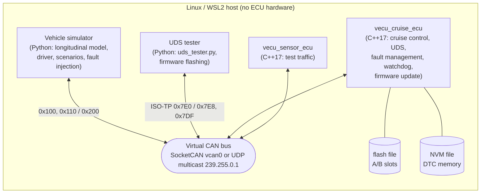
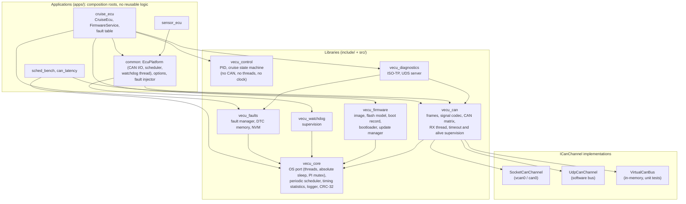
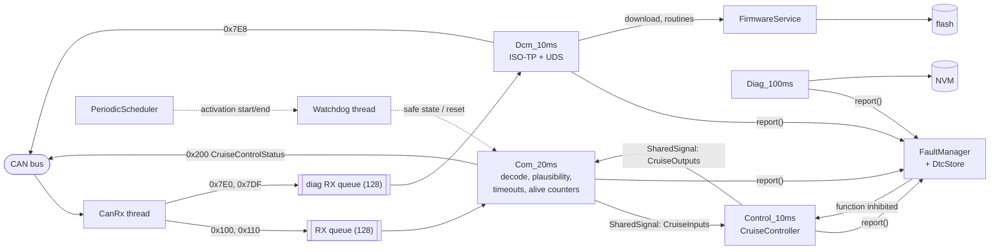
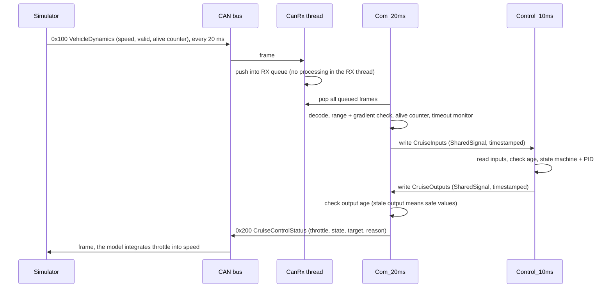
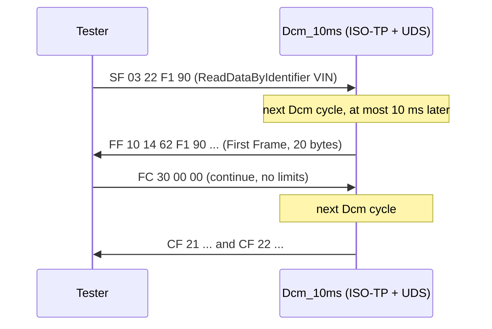
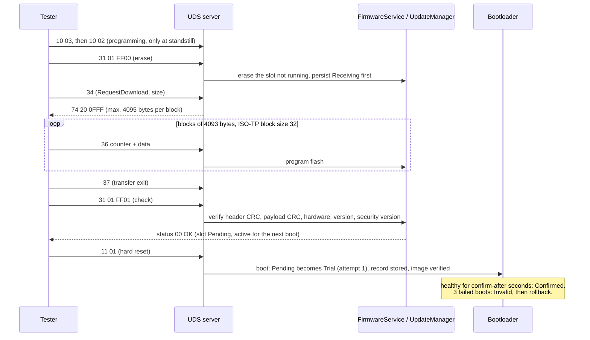
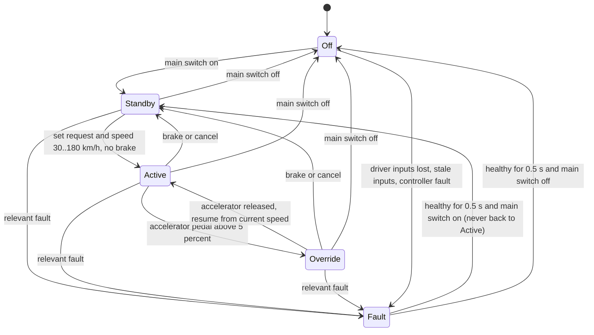
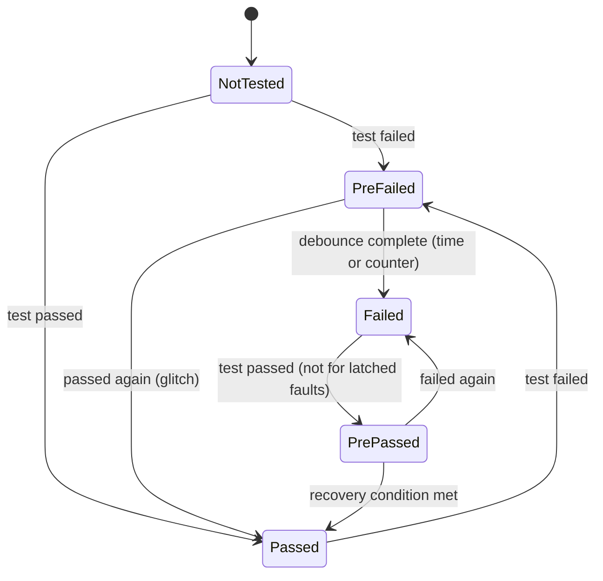
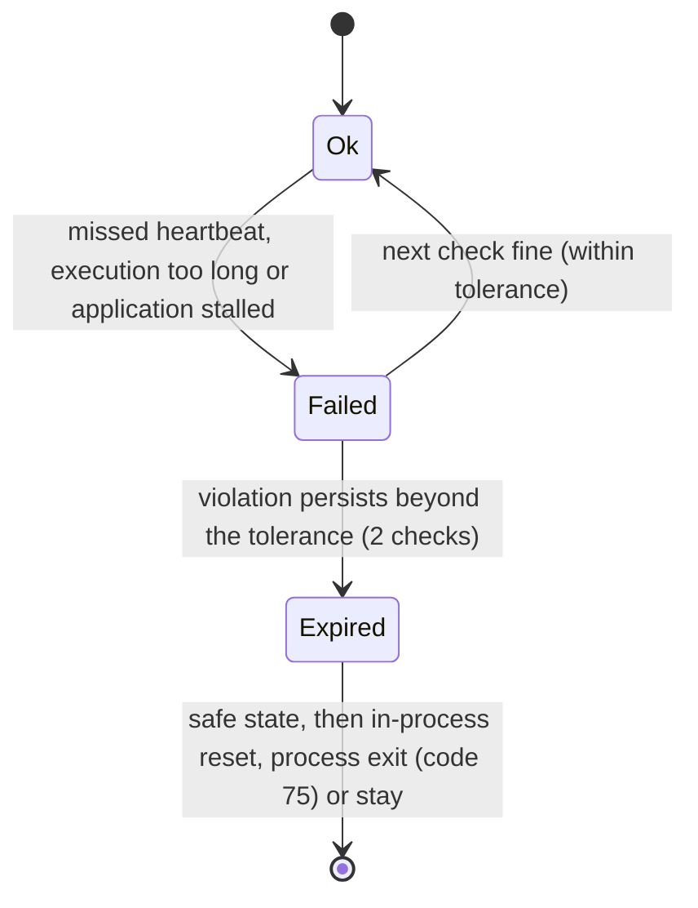
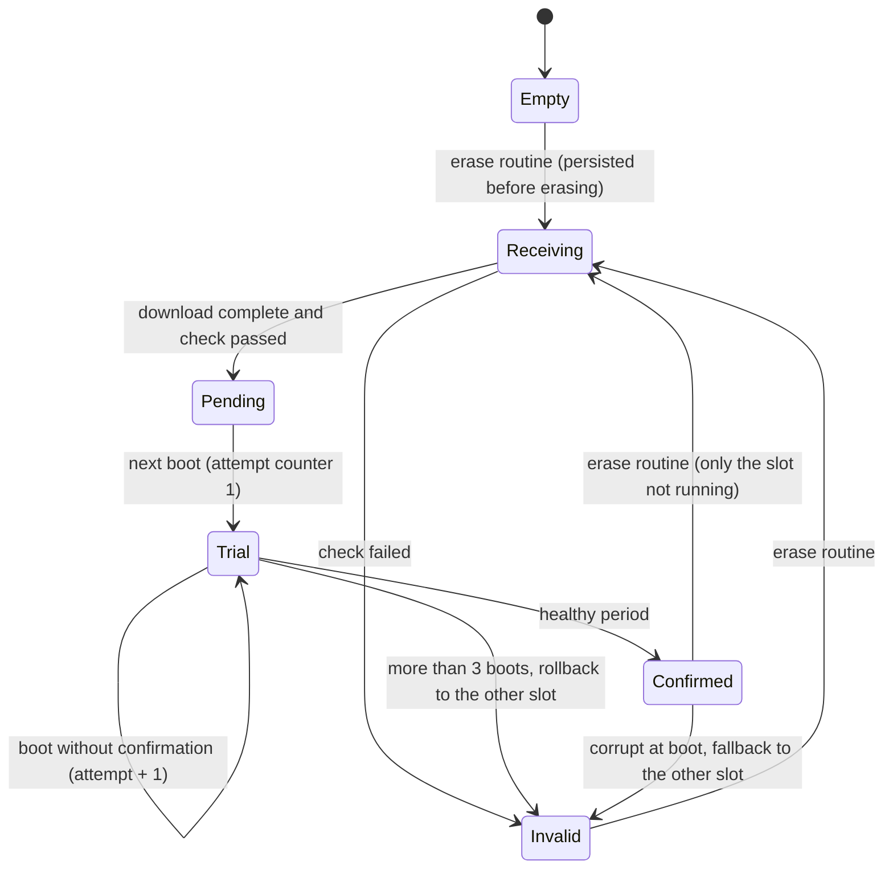

# Architecture

This document describes the platform as a whole: what runs where, which module depends on
which, how data moves through an ECU in one control cycle, and the state machines behind the
behaviour. The per-phase documents explain each part in depth. Engineering decisions are
collected in [engineering_decisions.md](engineering_decisions.md).

Diagrams are written in [Mermaid](https://mermaid.js.org/), which GitHub renders directly.

---

## 1. System context

Everything runs as ordinary Linux processes on one machine (WSL2). The processes talk only over
the CAN abstraction: Linux SocketCAN (`vcan0`) where the kernel supports it, otherwise the UDP
software CAN bus.

**What is simulated and what is real.** The software is real C++/Python that runs, schedules,
encodes frames, diagnoses and verifies images. Four things are simulated:
- the hardware: there is no microcontroller, CAN controller or flash chip
- the bus timing: there is no bit timing or arbitration
- the vehicle: it is a mathematical model
- the "firmware": an image is data that decides the ECU's version and behaviour

Linux is not a real-time OS, so all timing figures are measurements, not guarantees.

---

## 2. Software layers

Rules behind this structure:
- **The control algorithm is pure logic.** `vecu_control` depends on nothing but the standard
  library. It gets inputs as a struct and returns outputs, so the same code runs in unit tests
  with a synthetic clock, in the C++ closed-loop test plant, and in the real ECU.
- **One interface for all buses.** Everything above `ICanChannel` is identical for SocketCAN,
  the UDP bus and the in-memory test bus.
- **Protocol and application are separate.** The UDS server does not know about flash or
  cruise control. The application plugs in DIDs, routines, a download handler and session
  hooks.
- **Composition happens only in `apps/`.** `main()` and the `CruiseEcu` class wire libraries
  together, and all logic worth testing lives in the libraries.
- **The OS port is the replacement point for an RTOS.** Threads, absolute sleep and the
  priority-inheritance mutex are behind `os_port`, and the scheduler uses only that.

---

## 3. Inside the cruise ECU: threads, tasks and data flow

| Thread / task | Priority* | Period | Work |
|---|---|---|---|
| Watchdog | 95 | 20 ms | checks heartbeats, execution times and stalls of all tasks; safe state and recovery |
| CanRx | 90 | event | blocking receive; routes frames to the COM queue or the diagnostic queue |
| Control_10ms | 80 | 10 ms | cruise state machine + PID → throttle command |
| Dcm_10ms | 75 | 10 ms | ISO-TP + UDS server, firmware download |
| Com_20ms | 70 | 20 ms | decode + check received signals, timeout/alive supervision, transmit 0x200 |
| Diag_100ms | 50 | 100 ms | deadline-miss monitor, fault events, NVM write, trial-image confirmation |

\* `SCHED_FIFO` priorities when started with `--realtime` and the permission to use them;
otherwise all run as `SCHED_OTHER` and the priorities are only recorded.

Tasks never share mutable state directly. They exchange data through:
- **`SharedSignal<T>`**: a value with a timestamp and a sequence number, guarded by a
  priority-inheritance mutex. The reader can see how old the data is, which is the basis of the
  stale-input and stale-output checks.
- **Bounded queues**: the CAN RX queues hold 128 frames; when full they count the overrun
  instead of blocking.
- **Thread-safe services**: the fault manager and the firmware service each hold one internal
  mutex.

### 3.1 One control cycle

### 3.2 A diagnostic request (multi-frame response)

### 3.3 Firmware update

---

## 4. CAN matrix

Defined in [`config/vehicle_can.dbc`](../config/vehicle_can.dbc); the C++ signal table and the
Python DBC parser are checked against each other by tests.

| ID | Message | Sender → receiver | Cycle | Timeout | Content |
|---|---|---|---|---|---|
| 0x100 | VehicleDynamics | simulator → cruise ECU | 20 ms | 100 ms | speed (0.01 km/h), acceleration, speed valid, alive counter |
| 0x110 | DriverInputs | simulator → cruise ECU | 50 ms | 250 ms | pedals, main switch, set/cancel, desired speed, alive counter |
| 0x200 | CruiseControlStatus | cruise ECU → simulator | 20 ms | (supervised by the simulator) | throttle command, cruise state, target speed, fault reason, alive counter |
| 0x7E0 / 0x7E8 | UDS physical request / response | tester ↔ cruise ECU | on request | P2 50 ms, S3 5 s | ISO-TP |
| 0x7DF | UDS functional request | tester → all | on request | | single frame only |

---

## 5. State machines

### 5.1 Cruise control (`CruiseController`)

In `Fault`, the throttle command is 0 % and the reason is transmitted in 0x200. Relevant faults
include speed timeout or invalid, driver-input timeout, stale inputs, a controller fault, and
function inhibition by the fault manager, the watchdog safe state, the programming session or
bootloader mode.

### 5.2 Fault qualification (`FaultManager`, per fault)

`Failed` and `PrePassed` count as active (DTC `testFailed`, function inhibition). A latched fault
leaves `Failed` only at the next operation cycle (start, hard reset, watchdog reset).

### 5.3 Software watchdog (per supervised task)

After an in-process reset, the ECU leaves the safe state only after 200 ms of healthy
supervision. After 3 watchdog resets in one operation cycle it stays in the safe state.

### 5.4 Firmware slot (`BootRecord`)

---

## 6. Where to look

| Topic | Code | Document |
|---|---|---|
| CAN abstraction, signal codec, supervision | `include/can`, `src/can` | [Phase 1](phase1_virtual_can.md) |
| Scheduler, OS port, timing | `include/core`, `src/core` | [Phase 2](phase2_scheduler.md) |
| PID, cruise state machine, vehicle model | `include/control`, `simulator/vecu_sim` | [Phase 3](phase3_cruise_control.md) |
| ISO-TP, UDS | `include/diagnostics` | [Phase 4](phase4_diagnostics.md) |
| Fault manager, DTCs, NVM, watchdog | `include/faults`, `include/watchdog` | [Phase 5](phase5_fault_management.md) |
| Firmware update | `include/firmware`, `apps/cruise_ecu/firmware_service.*` | [Phase 6](phase6_firmware_update.md) |
| Validation, CI, measurements | `tests`, `scripts`, `.github/workflows` | [Phase 7](phase7_validation.md), [performance report](performance_report.md) |
