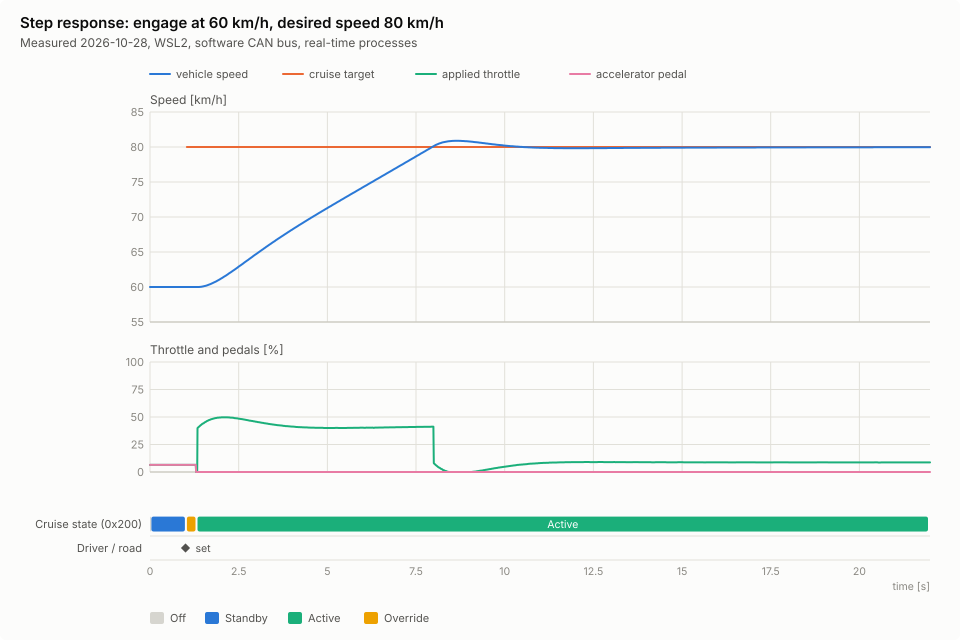
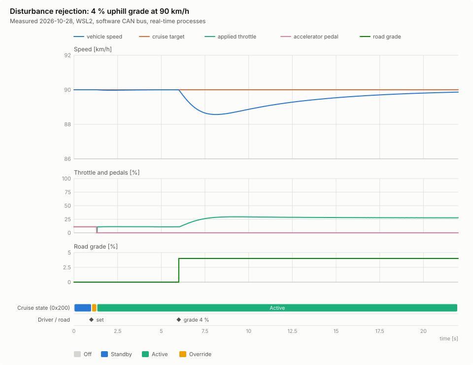
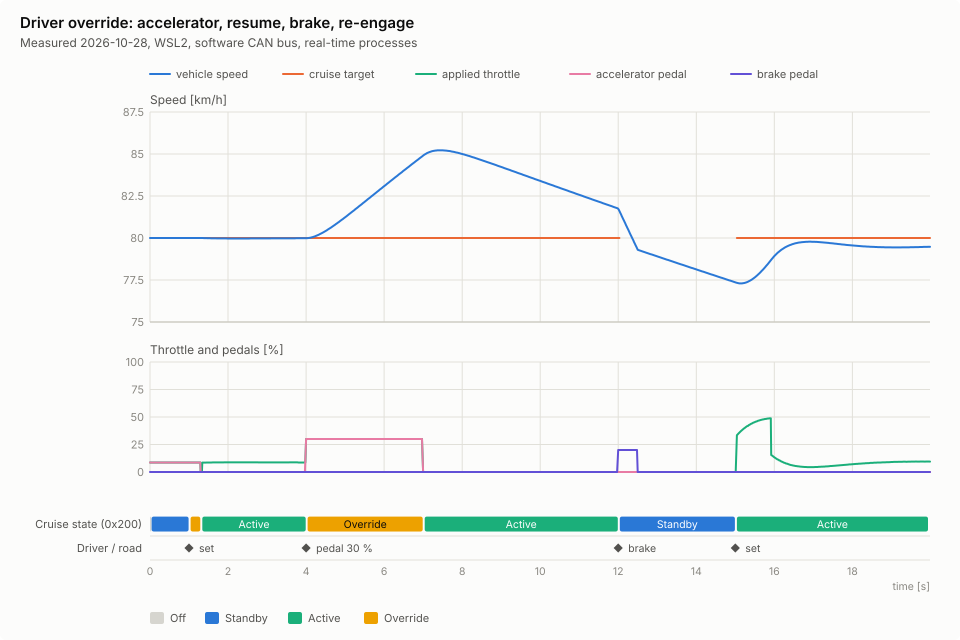
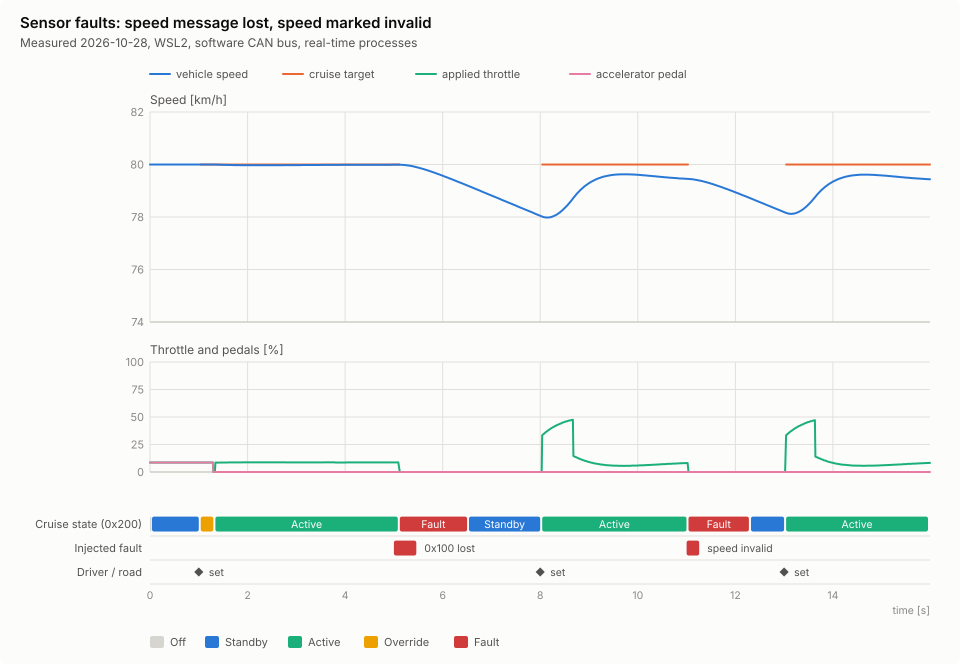
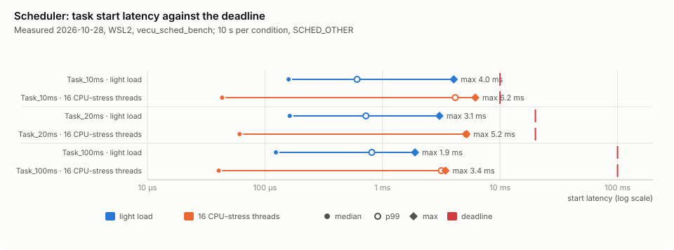
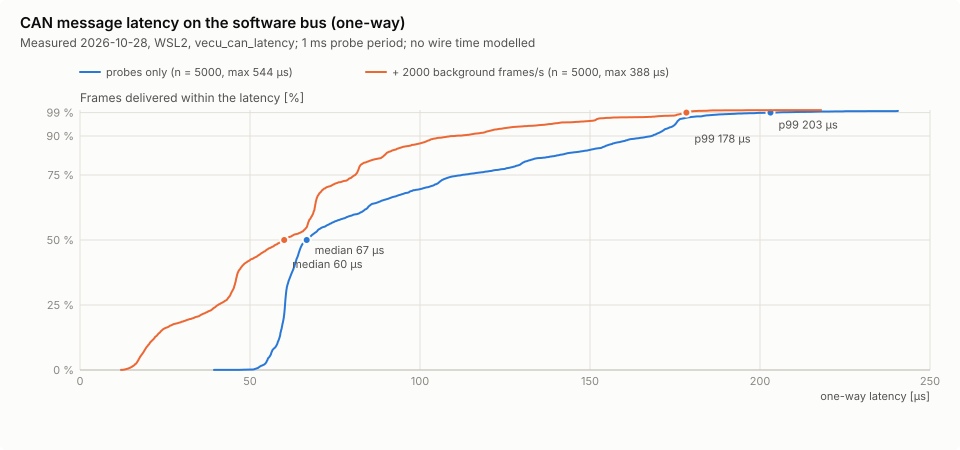
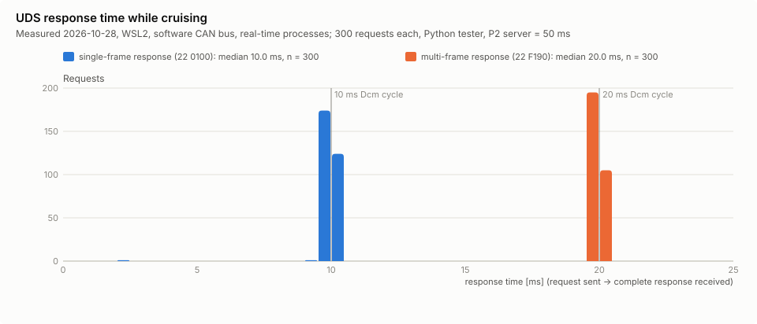

# Results Gallery

Every figure on this page is drawn from data recorded in **one run** of
`./scripts/make_figures.py`: simulator time series, ECU logs, the ECU's CAN trace and benchmark
samples. Nothing is synthesised. The numbers printed inside a figure are measured values of that
run, and the date is in each figure's subtitle. Re-running the script redraws all figures and the
values change slightly from run to run (Linux/WSL2 is not a real-time OS). The tables of the
[performance report](performance_report.md) hold the same kinds of measurements in text form.

```bash
./scripts/make_figures.py                   # ~2.5 min; writes docs/images/fig_*.svg, raw data in logs/figures/
./scripts/make_figures.py --only firmware   # one group: closed_loop | faults | firmware | timing
```

---

## 1. Closed-loop cruise control (ECU + vehicle simulator over CAN, real time)

Each figure shares one time axis across its panels:
- **Speed**: the vehicle speed from the simulator and the cruise target the ECU transmits in 0x200
  (drawn only while the target is set).
- **Throttle and pedals**: the throttle the vehicle actually applies, plus the driver's pedals,
  which are drawn only if pressed in that run.
- **Road grade**, when the scenario has one.
- **Lanes**: the cruise state as received on the bus, injected faults, and driver or road events
  from the scenario.

### Full drive


1. The driver accelerates manually (accelerator pedal = applied throttle).
2. They press SET at ~50 km/h with a desired speed of 80 km/h; the controller ramps the speed up
   without overshoot.
3. The desired speed is raised to 100 km/h.
4. A 4 % hill raises the throttle need; the speed dip is small and recovered.
5. Braking disengages the cruise control (Active → Standby, throttle to 0).

### Step response


Engage at 60 km/h with a desired speed of 80 km/h. The setpoint ramps at a comfort limit, the
throttle saturates at 60 % (configured limit), and the speed settles with a small overshoot.

### Disturbance rejection: uphill grade


At 6 s the road climbs 4 %. The integrator raises the throttle and the speed drop stays small.

### Driver override


1. The accelerator pressed above the cruise command → **Override**; the driver is in control.
2. On release the cruise control resumes from the current speed.
3. The brake disengages it to **Standby**.
4. SET re-engages it.

### Sensor faults


Two faults, two reactions:
- The **speed message stops** (0x100 not sent for 0.5 s). After the 100 ms timeout the ECU goes to
  **Fault** with 0 % throttle and returns only to **Standby**, never directly to Active.
- The sender marks the **speed as invalid**. There is no timeout and no debounce to wait for, so the
  reaction takes only a few message and task cycles.

---

## 2. On the bus: what a timeout looks like


The cruise ECU's own CAN trace (candump format), one lane per message, one tick per frame. When
0x100 stops, 0x110 keeps arriving. The 0x200 frames, coloured by the state they carry, switch to
**Fault** a little more than the 100 ms timeout later: the timeout plus at most one 20 ms COM-task
period. The note under the axis gives the measured delay.

---

## 3. Fault management: all fault classes in one run


One row per fault:
- the **thin grey bar** at the top is the injected *cause* (simulator signal faults, or test-only
  ECU injections)
- the **red bar** is the time the fault was *active*: qualified by debouncing until recovered

What to notice:
- **Signal faults** (speed spike, frozen alive counter) qualify within tens of milliseconds and
  heal on their own.
- **The task overrun** qualifies as `TaskDeadlineMiss` after two failing 100 ms windows, and heals
  after 10 clean ones.
- **Latched faults** (`WatchdogExpired`, `ControllerFault`) stay active until the next operation
  cycle; here that is the UDS hard reset.
- **The bottom lane** shows the cruise function's reaction on the bus each time.

---

## 4. Software watchdog: a stalled task


The Control task is blocked for 400 ms (test-only injection). Two independent mechanisms react:
1. **The COM task** notices that the control output is no longer refreshed and transmits safe values
   (Fault, 0 % throttle) within a few cycles.
2. **The watchdog** expires shortly after, and resets the application as soon as the task responds
   again.

After 200 ms of healthy supervision the safe state is left. The cruise control then waits in
Standby until the driver re-engages; it never resumes by itself.

---

## 5. Firmware update: trial boot, confirmation, rollback


Polled through UDS by the tester:
- the running version (DID F189)
- the state of both flash slots (DID 0x0400)
- the download progress

The run shows:
1. **00.07.00** is downloaded into slot B and boots as a **Trial**; it is **Confirmed** after the
   healthy period.
2. The defective **00.09.00** goes into slot A (the update always targets the slot that is not
   running) and boots as a Trial. It hangs, the watchdog exits the process (code 75), and the
   test restarts the ECU, as a hardware watchdog reset would.
3. After three failed trial boots the bootloader marks slot A **Invalid** and **rolls back** to the
   confirmed 00.07.00.

---

## 6. Timing

### Scheduler: start latency against the deadline


Start latency is the delay between a task's planned release and its actual start, shown as median,
p99 and maximum on a log axis, with each task's deadline. Under 16 CPU-stress threads the median
is often *lower* (busy CPUs do not enter deep idle states) but the tail grows by an order of
magnitude, sometimes up to the deadline. That is why `--realtime` (SCHED_FIFO) exists.

### CAN message latency


The distribution (CDF) of the one-way latency on the software bus: `send()` → kernel → receiving
thread. With background traffic the latency is *lower*, the same idle-wake-up effect as above.
A physical CAN bus would add the frame's wire time, which a software bus does not model.

### UDS response time


Responses cluster at 10 ms (single frame) and 20 ms (multi-frame) because the diagnostic task runs
every 10 ms. A multi-frame response needs one more cycle for the tester's flow control. Both stay
far below the 50 ms P2 limit.

---

## How the figures are made

- **Toolkit:** `simulator/vecu_sim/svg_charts.py` (no third-party packages). The figures are in
  `simulator/vecu_sim/figures.py` and the runs in `scripts/make_figures.py`; unit tests are in
  `tests/unit/python/test_svg_charts.py`.
- **Colours and form:**
  - Colours come from one reference palette (categorical slots in a fixed order). Status red and
    green appear only where they mean a state, always next to a text label.
  - One y-axis per panel; different units go into separate panels with a shared time axis.
  - Thin lines; a legend for every multi-series chart.
  - Labels never overlap or get clipped: they move outside a bar or merge when there is no room.
- **Light and dark:** every colour is a plain SVG attribute (light), and a `prefers-color-scheme:
  dark` style block overrides it. Viewers without CSS show the light version.
- **Size:** lines are reduced to points that change the drawing at its size (more than 1 px in x
  or 0.5 px in y), so a 22 s run at 10 ms steps is a few kB, not hundreds. The raw data is in
  `logs/figures/`.
- **One time axis for different processes:** ECU events carry `t=...s` on the ECU's scheduler
  clock, and the ECU logs that clock's wall-clock origin (`SCHED_EPOCH`). The simulator reports the
  wall-clock time of its t = 0. Accuracy is a few milliseconds.

### A bug the figures found
The first CAN-trace figure showed **0.85 s without any frame**, although the simulator had
received the ECU's status frames without interruption. Counting frames proved that none were lost:
the trace timestamps (wall clock) had jumped forward. WSL2 had stepped the system clock while
re-syncing with Windows. CAN traces and the ECU's epoch anchor now use a **steady wall clock**: the
wall clock read once, advanced by the monotonic clock (`core::steadyWallMicros`). Timing decisions
never used the wall clock, so only the recorded traces were affected.

### Limitations
- The figures are static images (GitHub shows SVGs without scripts): no hover or zoom. The values
  are in the figure labels, the performance report and the raw data.
- Each figure is one run on one machine. Run-to-run variation is visible in the performance
  report history, not in a single figure.
- The palette is the documented reference palette, but its colour-vision-deficiency checks could
  not be re-run here (the validator needs Node.js, which is not installed). Identity never relies
  on colour alone: every coloured mark has a legend entry or a text label.
- The firmware figure is sampled by tester polling (every ~0.1 s, none during a download), so
  states shorter than that (e.g. `Pending` between check and reset) do not appear.
